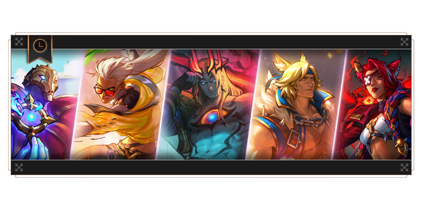
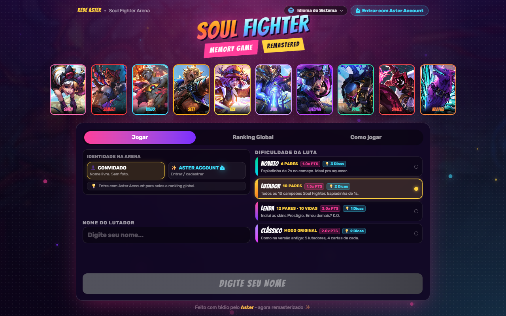
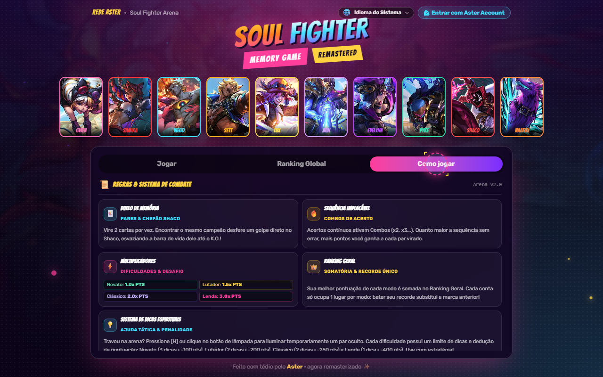
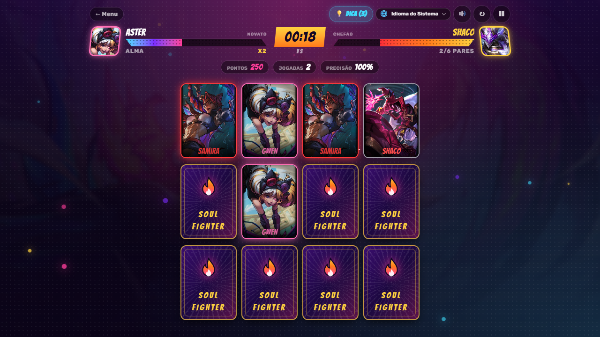
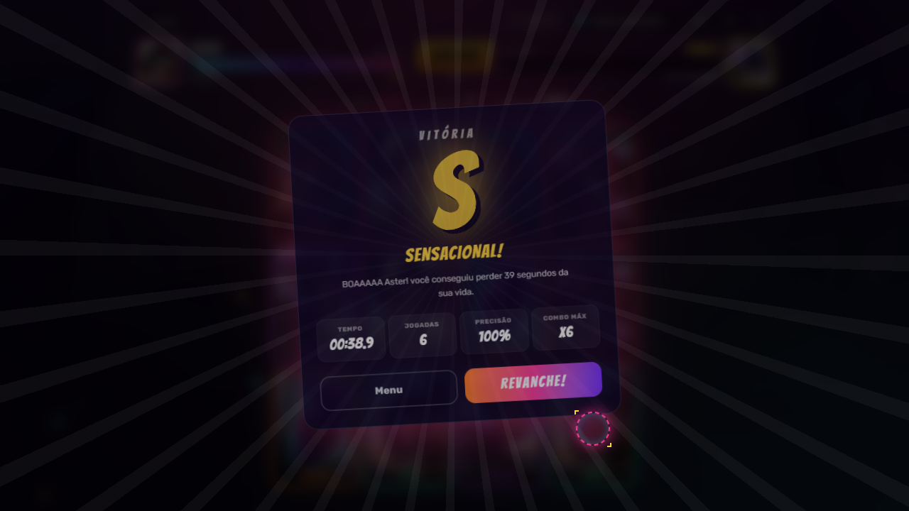
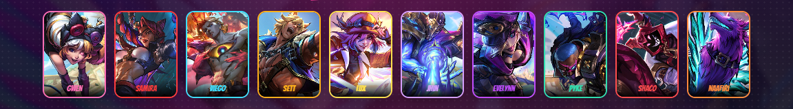
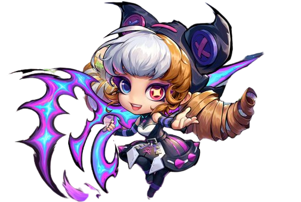

<div align="center">

  

  <p align="center">
    <strong>Entre no Torneio das Almas! Teste sua memória, encadeie combos frenéticos e dispute o topo do ranking global na arena Soul Fighter.</strong>
  </p>

  <p align="center">
    <a href="https://soulfighter.asterdev.me/"><strong>🕹️ JOGAR AGORA (DEMO ONLINE)</strong></a>
  </p>

  <p align="center">
    
    
    
    
    
  </p>

</div>

---

## 📌 Sobre o Projeto

O **Soul Fighter Memory Game** é uma releitura completa e remasterizada do clássico jogo da memória, ambientado no universo dinâmico e estiloso do evento **Soul Fighter** de *League of Legends* e *Legends of Runeterra*.

Totalmente reconstruído com **React 19**, **TypeScript**, **Tailwind CSS 4** e integrado ao ecossistema da **Rede ASTER** via **Supabase**, o jogo traz uma experiência digna de jogos de luta arcade: trilha sonora imersiva, sistema de combos dinâmicos, ranking global em tempo real e suporte a múltiplos idiomas.

---

## 📸 Telas e Demonstração

### 🎮 Menu Principal & Arena
<div align="center">
  
  
</div>

<br/>

### ⚔️ Partida em Ação & Finalização
<div align="center">
  
  
</div>

<br/>

### 🃏 Elenco Oficial dos Campeões Soul Fighter
<div align="center">
  
</div>

<div align="center">
  <sub><strong>Gwen</strong> • <strong>Samira</strong> • <strong>Viego</strong> • <strong>Sett</strong> • <strong>Lux</strong> • <strong>Jhin</strong> • <strong>Evelynn</strong> • <strong>Pyke</strong> • <strong>Shaco</strong> • <strong>Naafiri</strong></sub>
</div>

---

## ✨ Funcionalidades Principais

- 🥊 **4 Modos de Jogo Distintos**: Do nível casual ao mais impiedoso com limite de vidas.
- ⚡ **Sistema de Combos & Ranking de Performance**: Acertos consecutivos geram multiplicadores de pontuação e classificações finais de estilo (**S+**, **S**, **A**, **B**, **C**).
- 🏆 **Leaderboard Global em Tempo Real**: Tabelas de classificação individuais por dificuldade e ranking geral de mestres com persistência no Supabase.
- 👤 **Integração com Aster Accounts**: Login global unificado, avatares dinâmicos, badges VIP e status de presença ao vivo.
- 🌐 **16 Idiomas Suportados (i18n)**: Interface traduzida para Português (BR/PT), Inglês, Espanhol, Francês, Alemão, Italiano, Russo, Japonês, Coreano, Chinês, Árabe, Vietnamita, Indonésio e Holandês.
- 💡 **Sistema de Dicas Inteligentes**: Revela brevemente um par no tabuleiro com penalidade estratégica de pontuação.
- 🎵 **Áudio Imersivo & Efeitos Arcade**: Trilha sonora da arena Soul Fighter com controles de volume de música e efeitos sonoros para flips, acertos e erros.
- 🖱️ **Cursores Customizados**: Cursores temáticos inspirados no estilo visual arcade e nos lutadores.

---

## 🎯 Modos de Dificuldade

| Modo | Cartas / Pares | Espiadinha Inicial | Vidas | Multiplicador | Dicas | Descrição |
| :--- | :---: | :---: | :---: | :---: | :---: | :--- |
| **Novato** | 12 cartas (6 pares) | 2.0s | Ilimitadas | **1.0x** | 3 | Aquecimento ideal para aprender as regras e treinar a mente. |
| **Lutador** | 20 cartas (10 pares) | 1.0s | Ilimitadas | **1.5x** | 2 | Todos os 10 campeões da linha Soul Fighter na arena. |
| **Lenda** | 24 cartas (12 pares) | 1.0s | **10 Vidas** | **3.0x** | 1 | Inclui skins Prestígio. Cada erro custa uma vida: errou demais, K.O.! |
| **Clássico** | 20 cartas (5 lutadores × 4) | Nenhuma (0s) | Ilimitadas | **2.0x** | 2 | A nostálgica versão original: encontre as 4 cópias de cada lutador. |

---

## 🛠️ Tecnologias Utilizadas

- **[React 19](https://react.dev/)** — Interface declarativa e componentes performáticos
- **[TypeScript](https://www.typescriptlang.org/)** — Tipagem estática robusta
- **[Vite 7](https://vite.dev/)** — Build tool ultra-rápida e Hot Module Replacement
- **[Tailwind CSS v4](https://tailwindcss.com/)** — Estilização moderna e responsiva
- **[Supabase](https://supabase.com/)** — Autenticação segura, PostgreSQL, RPCs e Presence Realtime
- **[Data Dragon API (Riot Games)](https://developer.riotgames.com/)** — Assets oficiais e ilustrações em alta resolução dos campeões

---

## 🚀 Como Executar o Projeto

### Pré-requisitos
Certifique-se de ter instalado em sua máquina:
- [Node.js](https://nodejs.org/) (versão 18 ou superior recomendada)
- Gerenciador de pacotes `npm`, `yarn` ou `pnpm`

### Instalação

1. **Clone o repositório:**
   ```bash
   git clone https://github.com/zAstergun/Soul-Fighter-Memory-Game.git
   cd Soul-Fighter-Memory-Game
   ```

2. **Instale as dependências:**
   ```bash
   npm install
   ```

3. **Inicie o servidor local de desenvolvimento:**
   ```bash
   npm run dev
   ```

4. Abra `http://localhost:5173` no seu navegador para jogar!

### Build de Produção

Para gerar a versão otimizada de produção:
```bash
npm run build
```

---

## 🔗 Créditos e Referências

- **Tema & Universo:** Soul Fighter — [League of Legends / Riot Games](https://playruneterra.com/pt-br/news/game-updates/notas-da-atualizacao-4-6-0/)
- **Artes e Campeões:** Riot Games Data Dragon & Runeterra Universe.
- **Desenvolvido por:** [zAstergun](https://github.com/zAstergun) • **Rede ASTER**

---

<div align="center">
  
  <p><sub>Feito com carinho e paixão pelo torneio Soul Fighter ✂️✨</sub></p>
</div>
